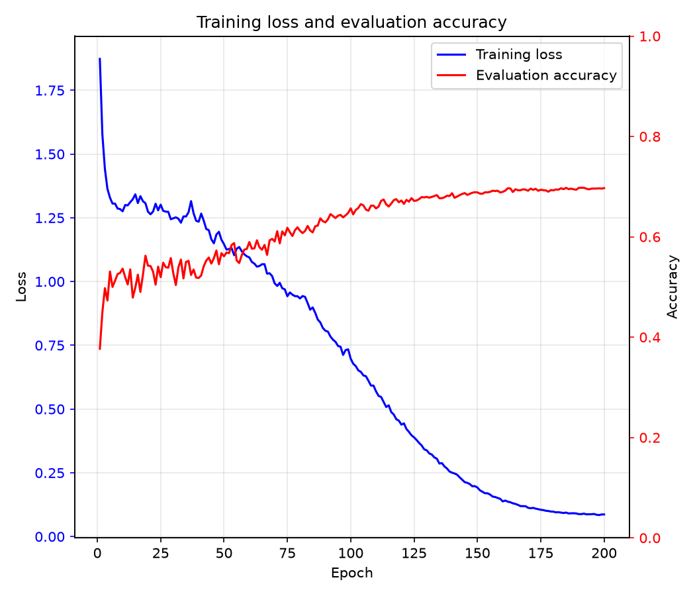
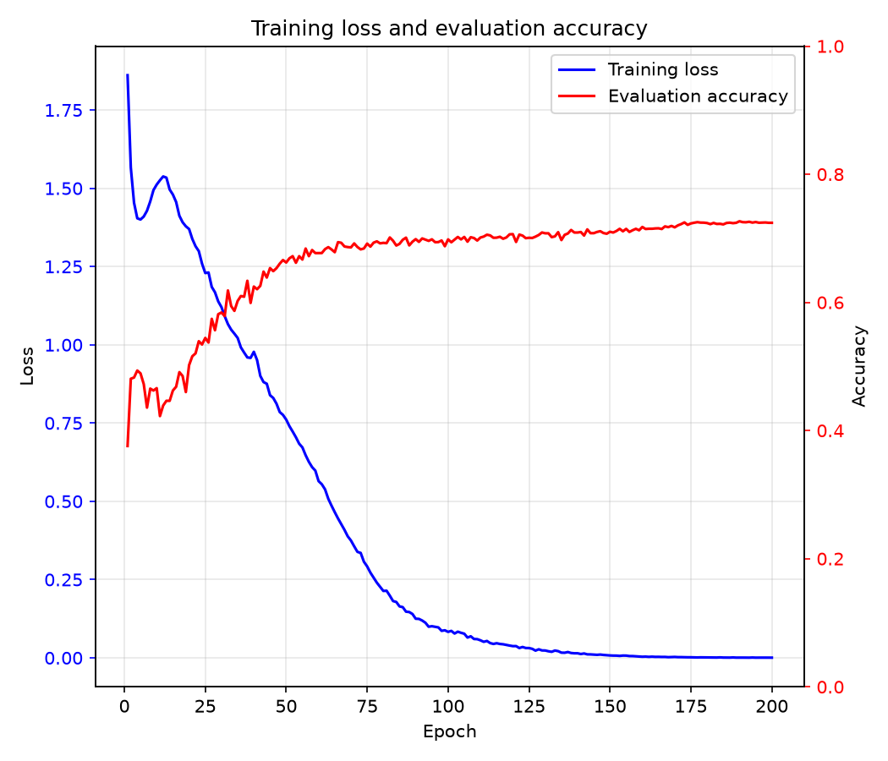

English | [简体中文](README.zh-CN.md)

# Vision Transformer from Scratch in PyTorch

### A full implementation of Vision Transformer (ViT) with reproducible CIFAR-10 and MNIST experiments

This is not a vibe-coding project. it is a from-scratch implementation intended for learning the principles of Vision Transformers.

The model and Transformer components are implemented in [model.py](model.py). The training loop, evaluation, checkpointing, and training curves are implemented in [train.py](train.py).

## Overview

- Implements the main building blocks of Vision Transformer from the [ViT paper](https://arxiv.org/pdf/2010.11929.pdf): patch embedding, learnable positional embedding, a CLS token, pre-norm Transformer blocks, multi-head self-attention, GELU/SwiGLU feed-forward networks, and a classifier head.
- Provides three full-scale configurations: ViT-B/16, ViT-L/16, and ViT-H/14; parameter counts vary slightly between RGB and grayscale inputs.
- Includes training scripts for both CIFAR-10 and MNIST. CIFAR-10 uses RGB inputs, while 28×28 grayscale MNIST images are resized to 224×224.
- Supports BF16 mixed-precision training, gradient accumulation, fused AdamW, linear learning-rate warmup, and cosine decay.
- Saves resumable `last.pt` and `best.pt` checkpoints together with optimizer, scheduler, and training history state.
- Records each experiment under `runs/<experiment>/<run_id>/` so configurations, metrics, and curves can be compared and reproduced.
- Supports MNIST, FashionMNIST, CIFAR-10, CIFAR-100, and ImageNet-1K data loading; reproducible experiment scripts are provided for CIFAR-10 and MNIST.

## Directory Structure

```text
ViT/
├── train.py                         # Training, evaluation, checkpointing, and plotting
├── model.py                         # ViT model and Transformer components
├── data_loader.py                   # Datasets, transforms, and DataLoader construction
├── optim.py                         # AdamW optimizer construction
├── requirements.txt                 # Python dependencies
├── script/
│   ├── cifar10_b16_224.sh           # CIFAR-10 ViT-B/16 experiment
│   ├── cifar10_l16_224.sh           # CIFAR-10 ViT-L/16 experiment
│   ├── cifar10_h14_224.sh           # CIFAR-10 ViT-H/14 experiment
│   ├── mnist_b16_224.sh             # MNIST ViT-B/16 experiment
│   ├── mnist_l16_224.sh             # MNIST ViT-L/16 experiment
│   └── mnist_h14_224.sh             # MNIST ViT-H/14 experiment
├── data/                            # Dataset directory, kept out of Git
├── runs/                            # Experiment records, committed to Git
│   └── cifar10_<model>_224/
│       └── <run_id>/
│           ├── args.txt             # Resolved command-line arguments
│           ├── metrics.json         # Train loss, test accuracy, and learning rate
│           ├── training_curves.png  # Training history plots
│           ├── checkpoints/         # Local-only last.pt and best.pt
│           └── logs/                # Local-only terminal training log
├── .venv/                           # Python virtual environment, kept out of Git
├── .gitignore
├── README.md
└── README.zh-CN.md                  # Simplified Chinese README
```

## Usage

Run the script from the repository root:

```bash
# CIFAR-10 with ViT-B/16
./script/cifar10_b16_224.sh

# CIFAR-10 with ViT-L/16
./script/cifar10_l16_224.sh

# CIFAR-10 with ViT-H/14
./script/cifar10_h14_224.sh

# MNIST with ViT-B/16
./script/mnist_b16_224.sh

# MNIST with ViT-L/16
./script/mnist_l16_224.sh

# MNIST with ViT-H/14
./script/mnist_h14_224.sh
```

- All architecture, optimization, and output settings are kept explicitly in the shell scripts.
- Each run is stored under `runs/<experiment>/<YYYYMMDD_HHMMSS>_<PID>/` and contains configuration, metrics, and training curves, while checkpoints and logs are kept locally.
- To run a new experiment or change the configuration, create a dedicated shell job script.

For a custom minimal invocation, pass all required arguments directly:

```bash
.venv/bin/python train.py \
    --dataset cifar10 \
    --data-path ./data \
    --image-size 224 \
    --device cuda:<GPU_ID> \
    --in-channels 3 \
    --num-classes 10
```

The direct command uses the defaults in [train.py](train.py). Use the shell scripts when reproducing the committed B/16, L/16, or H/14 configurations.

## Experiments and Performance

### CIFAR-10

The table reports the best CIFAR-10 test accuracy saved in `metrics.json`. `best.pt` is selected according to this test metric.

| Model | Run Command | Epochs | Best Test Accuracy | Final Test Accuracy | Status |
|---|---|---:|---:|---:|---|
| ViT-B/16 (86.43M) | `./script/cifar10_b16_224.sh` | 200 | **69.77%** | 69.70% | Complete |
| ViT-L/16 (304.46M) | `./script/cifar10_l16_224.sh` | 200 | **72.66%** | 72.42% | Complete |
| ViT-H/14 (632.58M) | `./script/cifar10_h14_224.sh` | 200 | — | — | In progress |

Detailed arguments and epoch-level metrics are stored in:

- [ViT-B/16 run](runs/cifar10_b16_224/20261113_221155_3864471/)
- [ViT-L/16 run](runs/cifar10_l16_224/20261113_221728_3874339/)

The B/16 and L/16 runs train for the full 200 epochs. Their training losses continue to decrease after validation accuracy stabilizes, which indicates clear overfitting.

| ViT-B/16 | ViT-L/16 | ViT-H/14 |
|---|---|---|
|  |  | *Training in progress* |

The plots contain training loss and test accuracy for every epoch.

### MNIST

| Model | Run Command | Epochs | Best Test Accuracy | Final Test Accuracy | Status |
|---|---|---:|---:|---:|---|
| ViT-B/16 (86.04M) | `./script/mnist_b16_224.sh` | 200 | — | — | In progress |
| ViT-L/16 (303.94M) | `./script/mnist_l16_224.sh` | 200 | — | — | In progress |
| ViT-H/14 (632.08M) | `./script/mnist_h14_224.sh` | 200 | — | — | In progress |

The MNIST runs are still training. Their `metrics.json` and `training_curves.png` files will be generated after all 200 epochs finish.

## Model Configurations

### ViT-B/16

| Parameter | Value |
|---|---:|
| Input size | 3 × 224 × 224 (CIFAR-10); 1 × 224 × 224 (MNIST) |
| Patch size | 16 × 16 |
| Sequence length (including CLS) | 197 |
| Embedding dimension | 768 |
| Transformer layers | 12 |
| Attention heads | 12 |
| Head dimension | 64 |
| FFN dimension | 3072 |
| FFN activation | GELU |
| Parameters | 86.43M |
| Effective batch size | 128 |
| Dropout | 0.1 |

### ViT-L/16

| Parameter | Value |
|---|---:|
| Input size | 3 × 224 × 224 (CIFAR-10); 1 × 224 × 224 (MNIST) |
| Patch size | 16 × 16 |
| Sequence length (including CLS) | 197 |
| Embedding dimension | 1024 |
| Transformer layers | 24 |
| Attention heads | 16 |
| Head dimension | 64 |
| FFN dimension | 4096 |
| FFN activation | GELU |
| Parameters | 304.46M |
| Effective batch size | 128 |
| Dropout | 0.1 |

### ViT-H/14

| Parameter | Value |
|---|---:|
| Input size | 3 × 224 × 224 (CIFAR-10); 1 × 224 × 224 (MNIST) |
| Patch size | 14 × 14 |
| Sequence length (including CLS) | 257 |
| Embedding dimension | 1280 |
| Transformer layers | 32 |
| Attention heads | 16 |
| Head dimension | 80 |
| FFN dimension | 5120 |
| FFN activation | GELU |
| Parameters | 632.58M |
| Effective batch size | 128 |
| Dropout | 0.1 |

### Shared Training Configuration

| Parameter | Value |
|---|---:|
| Datasets | CIFAR-10 and MNIST |
| CIFAR-10 images | 50,000 train / 10,000 test |
| MNIST images | 60,000 train / 10,000 test |
| Optimizer | AdamW |
| Peak learning rate | 3e-4 |
| Minimum learning rate | 1e-6 |
| Weight decay | 0.05 |
| Warmup | 5 epochs |
| Learning-rate schedule | Cosine decay |
| Mixed precision | BF16 |
| Seed | 42 |

## Implementation Notes

- A learnable CLS embedding is prepended to the patch sequence, and learnable positional embeddings are added to all tokens.
- Transformer blocks use pre-layer normalization, residual attention, and residual feed-forward sublayers.
- Weight decay is applied only to parameters with at least two dimensions in [optim.py](optim.py).
- Gradient accumulation normalizes the loss by the number of samples in each accumulation window.
- Training metrics and a resumable checkpoint are saved after every completed epoch.
- Uses learning-rate warmup followed by cosine annealing.
