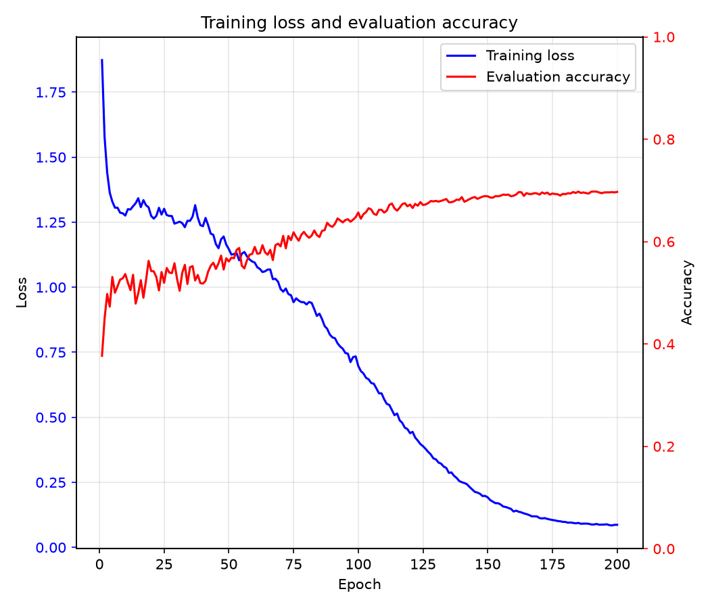
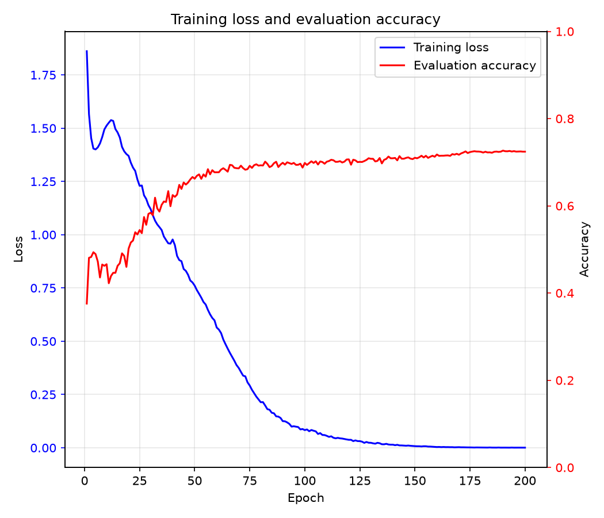

[English](README.md) | 简体中文

# 从零实现 Vision Transformer（PyTorch）

### 一个基于 Vision Transformer（ViT）的完整实现，以及可复现的 CIFAR-10 和 MNIST 实验

本项目不是 vibe coding 项目，而是用于学习 ViT 原理的从头实现（from scratch）项目。

模型及其 Transformer 组件位于 [model.py](model.py)。训练、评估、checkpoint、训练曲线等逻辑位于 [train.py](train.py)。

## 项目概述

- 实现了 [ViT 论文](https://arxiv.org/pdf/2010.11929.pdf)中的主要模块：图像分块嵌入、可学习位置编码、CLS token、预归一化 Transformer 块、多头自注意力、GELU/SwiGLU 前馈网络和分类头。
- 提供三种完整规模的配置：ViT-B/16、ViT-L/16 和 ViT-H/14；RGB 与灰度输入对应的参数量略有不同。
- 提供 CIFAR-10 和 MNIST 的训练脚本；CIFAR-10 使用 RGB 输入，28×28 的灰度 MNIST 图像会被缩放到 224×224。
- 支持 BF16 混合精度训练、梯度累积、fused AdamW、线性学习率预热和余弦退火。
- 保存可恢复训练的 `last.pt` 和 `best.pt`，同时保存优化器、调度器和训练历史状态。
- 每次实验都记录在 `runs/<experiment>/<run_id>/` 下，便于比较配置、指标和训练曲线并复现实验。
- 数据加载器支持 MNIST、FashionMNIST、CIFAR-10、CIFAR-100 和 ImageNet-1K；当前提供 CIFAR-10 和 MNIST 的可复现实验脚本。

## 目录结构

```text
ViT/
├── train.py                         # 训练、评估、checkpoint 和绘图
├── model.py                         # ViT 模型及 Transformer 组件
├── data_loader.py                   # 数据集、数据增强和 DataLoader 构建
├── optim.py                         # AdamW 优化器构建
├── requirements.txt                 # Python 依赖
├── script/
│   ├── cifar10_b16_224.sh           # CIFAR-10 ViT-B/16 实验
│   ├── cifar10_l16_224.sh           # CIFAR-10 ViT-L/16 实验
│   ├── cifar10_h14_224.sh           # CIFAR-10 ViT-H/14 实验
│   ├── mnist_b16_224.sh             # MNIST ViT-B/16 实验
│   ├── mnist_l16_224.sh             # MNIST ViT-L/16 实验
│   └── mnist_h14_224.sh             # MNIST ViT-H/14 实验
├── data/                            # 数据集目录，不提交到 Git
├── runs/                            # 实验记录目录，提交到 Git
│   └── cifar10_<model>_224/
│       └── <run_id>/
│           ├── args.txt             # 完整的命令行参数
│           ├── metrics.json         # 训练 loss、测试准确率和学习率
│           ├── training_curves.png  # 训练曲线
│           ├── checkpoints/         # 仅保留在本地的 last.pt 和 best.pt
│           └── logs/                # 仅保留在本地的终端训练日志
├── .venv/                           # Python 虚拟环境，不提交到 Git
├── .gitignore
├── README.md
└── README.zh-CN.md                  # 中文 README
```

## 使用方法

在仓库根目录运行实验脚本：

```bash
# 使用 ViT-B/16 训练 CIFAR-10
./script/cifar10_b16_224.sh

# 使用 ViT-L/16 训练 CIFAR-10
./script/cifar10_l16_224.sh

# 使用 ViT-H/14 训练 CIFAR-10
./script/cifar10_h14_224.sh

# 使用 ViT-B/16 训练 MNIST
./script/mnist_b16_224.sh

# 使用 ViT-L/16 训练 MNIST
./script/mnist_l16_224.sh

# 使用 ViT-H/14 训练 MNIST
./script/mnist_h14_224.sh
```

- 模型的全部架构、优化和输出配置都明确写在 shell 脚本中。
- 每次运行保存在 `runs/<experiment>/<YYYYMMDD_HHMMSS>_<PID>/` 下，其中包含配置、指标和训练曲线，checkpoint 与日志仅保留在本地。
- 如果要运行新的实验或调整配置，请新建一个 shell 作业文件。

也可以直接传入所有必需参数，运行一个最小化自定义任务：

```bash
.venv/bin/python train.py \
    --dataset cifar10 \
    --data-path ./data \
    --image-size 224 \
    --device cuda:<GPU_ID> \
    --in-channels 3 \
    --num-classes 10
```

直接执行时会采用 [train.py](train.py) 中的默认配置。复现已提交的 B/16、L/16 或 H/14 实验时，请使用对应的 shell 脚本。

## 实验与性能

### CIFAR-10

下表记录 `metrics.json` 中最佳的 CIFAR-10 测试准确率。`best.pt` 根据该测试指标选择。

| 模型 | 运行命令 | Epoch 数 | 最佳测试准确率 | 最终测试准确率 | 状态 |
|---|---|---:|---:|---:|---|
| ViT-B/16（86.43M） | `./script/cifar10_b16_224.sh` | 200 | **69.77%** | 69.70% | 已完成 |
| ViT-L/16（304.46M） | `./script/cifar10_l16_224.sh` | 200 | **72.66%** | 72.42% | 已完成 |
| ViT-H/14（632.58M） | `./script/cifar10_h14_224.sh` | 200 | — | — | 训练中 |

完整的参数和逐 epoch 指标位于：

- [ViT-B/16 运行记录](runs/cifar10_b16_224/20261113_221155_3864471/)
- [ViT-L/16 运行记录](runs/cifar10_l16_224/20261113_221728_3874339/)

B/16 和 L/16 都完成了全部 200 个 epoch。它们的验证准确率趋于稳定后，训练 loss 仍持续下降，说明模型存在明显的过拟合。

| ViT-B/16 | ViT-L/16 | ViT-H/14 |
|---|---|---|
|  |  | *训练中，图片待生成* |

图中分别展示了每个 epoch 的训练 loss 和测试准确率。

### MNIST

| 模型 | 运行命令 | Epoch 数 | 最佳测试准确率 | 最终测试准确率 | 状态 |
|---|---|---:|---:|---:|---|
| ViT-B/16（86.04M） | `./script/mnist_b16_224.sh` | 200 | — | — | 训练中 |
| ViT-L/16（303.94M） | `./script/mnist_l16_224.sh` | 200 | — | — | 训练中 |
| ViT-H/14（632.08M） | `./script/mnist_h14_224.sh` | 200 | — | — | 训练中 |

MNIST 实验仍在训练。全部 200 个 epoch 完成后，会生成对应的 `metrics.json` 和 `training_curves.png`。

## 模型配置

### ViT-B/16

| 参数 | 数值 |
|---|---:|
| 输入尺寸 | 3 × 224 × 224（CIFAR-10）；1 × 224 × 224（MNIST） |
| Patch 大小 | 16 × 16 |
| 序列长度（含 CLS） | 197 |
| 嵌入维度 | 768 |
| Transformer 层数 | 12 |
| 注意力头数 | 12 |
| 每个头的维度 | 64 |
| FFN 维度 | 3072 |
| FFN 激活函数 | GELU |
| 参数量 | 86.43M |
| 有效 batch size | 128 |
| Dropout | 0.1 |

### ViT-L/16

| 参数 | 数值 |
|---|---:|
| 输入尺寸 | 3 × 224 × 224（CIFAR-10）；1 × 224 × 224（MNIST） |
| Patch 大小 | 16 × 16 |
| 序列长度（含 CLS） | 197 |
| 嵌入维度 | 1024 |
| Transformer 层数 | 24 |
| 注意力头数 | 16 |
| 每个头的维度 | 64 |
| FFN 维度 | 4096 |
| FFN 激活函数 | GELU |
| 参数量 | 304.46M |
| 有效 batch size | 128 |
| Dropout | 0.1 |

### ViT-H/14

| 参数 | 数值 |
|---|---:|
| 输入尺寸 | 3 × 224 × 224（CIFAR-10）；1 × 224 × 224（MNIST） |
| Patch 大小 | 14 × 14 |
| 序列长度（含 CLS） | 257 |
| 嵌入维度 | 1280 |
| Transformer 层数 | 32 |
| 注意力头数 | 16 |
| 每个头的维度 | 80 |
| FFN 维度 | 5120 |
| FFN 激活函数 | GELU |
| 参数量 | 632.58M |
| 有效 batch size | 128 |
| Dropout | 0.1 |

### 共享训练配置

| 参数 | 数值 |
|---|---:|
| 数据集 | CIFAR-10 和 MNIST |
| CIFAR-10 图像数 | 训练集 50,000 / 测试集 10,000 |
| MNIST 图像数 | 训练集 60,000 / 测试集 10,000 |
| 优化器 | AdamW |
| 峰值学习率 | 3e-4 |
| 最小学习率 | 1e-6 |
| 权重衰减 | 0.05 |
| 预热 | 5 个 epoch |
| 学习率调度 | 余弦退火 |
| 混合精度 | BF16 |
| 随机种子 | 42 |

## 实现说明

- 在 patch 序列前添加可学习的 CLS 嵌入，并为全部 token 添加可学习位置编码。
- Transformer 块采用预归一化、带残差的注意力和带残差的前馈网络。
- 在 [optim.py](optim.py) 中，仅对维度至少为 2 的参数应用权重衰减。
- 梯度累积时，会根据每个累积窗口中的样本总数对 loss 进行归一化。
- 每个 epoch 完成后都会保存训练指标和可恢复训练的 checkpoint。
- 学习率采用预热，随后进行余弦退火。
